# Flujo de generación de documentos

Este documento describe el flujo móvil completo para convertir una fotografía de un acta SUNAT en un PDF rellenado y almacenarlo en MinIO/S3.

## Flujo completo

```mermaid
flowchart LR
    A[Foto móvil] --> B[POST /upload/mobile]
    B --> C[Preprocesamiento de imagen]
    C --> D[OCR / transcripción]
    D --> E[Clasificación del documento]
    E --> F[Extracción de campos]
    F --> G[GET /template/:tipoDocumento]
    G --> H[Cliente completa o corrige datos]
    H --> I[POST /generate-document]
    I --> J[Lectura de HTML]
    J --> K[fillTemplate]
    K --> L[htmlToPdf / Puppeteer]
    L --> M[uploadFile / MinIO-S3]
    M --> N[documentos_generados / PostgreSQL]
    N --> O[URL o key del PDF + documentoId]
```



El flujo tiene dos etapas HTTP:

1. `POST /upload/mobile` procesa la fotografía y devuelve una clasificación y los campos extraídos.
2. `GET /template/:tipoDocumento` permite consultar la definición de la plantilla.
3. `POST /generate-document` recibe los datos finales, genera el PDF, lo sube al bucket y registra el documento.

La respuesta de `upload/mobile` no genera un PDF por sí sola. El cliente puede revisar o completar `campos` antes de llamar a `generate-document`.

## 1. Transcribir y clasificar una fotografía

### Request

El archivo debe enviarse como `multipart/form-data` en el campo `file`.

```bash
curl -X POST http://localhost:3000/upload/mobile \
  -F "file=@./acta-inmovilizacion.jpg"
```

Formatos de imagen aceptados por esta ruta:

- `image/jpeg`
- `image/jpg`
- `image/png`
- `image/heic`
- `image/heif`

### Response `200 OK`

```json
{
  "tipoDocumento": "ACTA_INMOVILIZACION",
  "confianza": 96,
  "campos": {
    "numeroActa": "AI-2026-000123",
    "fecha": "2026-10-14",
    "bienes": [
      {
        "numero": "1",
        "cantidad": "2",
        "unidadMedida": "UNIDAD",
        "descripcion": "Repuestos automotrices",
        "observaciones": ""
      }
    ]
  },
  "resumenEjecutivo": "Acta de inmovilización de mercancía",
  "templateSugerido": "ACTA_INMOVILIZACION"
}
```

### Errores

```json
// 400 Bad Request
{ "error": "No se envio ninguna imagen" }
```

```json
// 415 Unsupported Media Type
{ "error": "Tipo de imagen no soportado: text/plain" }
```

```json
// 500 Internal Server Error
{ "error": "Error interno procesando imagen" }
```

Un error 500 suele indicar que OCR u Ollama no están disponibles o que la imagen no pudo procesarse.

## 2. Consultar la plantilla

### Request

```bash
curl http://localhost:3000/template/ACTA_INMOVILIZACION
```

### Response `200 OK`

```json
{
  "tipoDocumento": "ACTA_INMOVILIZACION",
  "area": "Prevención del Contrabando",
  "campos": [
    {
      "nombre": "numeroActa",
      "label": "N° Acta",
      "tipo": "text",
      "requerido": true
    },
    {
      "nombre": "fecha",
      "label": "Fecha",
      "tipo": "text",
      "requerido": true
    },
    {
      "nombre": "bienes",
      "label": "Bienes",
      "tipo": "array",
      "subcampos": [
        { "nombre": "numero", "label": "N°", "tipo": "text" },
        { "nombre": "descripcion", "label": "Descripción", "tipo": "text" }
      ]
    }
  ]
}
```

La ruta acepta tipos con letras, números y guion bajo. Actualmente existen plantillas para `ACTA_INMOVILIZACION` y `ACTA_INCAUTACION`.

### Errores

```json
// 400 Bad Request: parámetro con caracteres no permitidos
{ "error": "Tipo de documento inválido" }
```

```json
// 404 Not Found: tipo válido pero sin definición
{ "error": "Plantilla no encontrada" }
```

## 3. Generar, subir y registrar el PDF

### Request

```bash
curl -X POST http://localhost:3000/generate-document \
  -H "Content-Type: application/json" \
  -d '{
    "tipoDocumento": "ACTA_INMOVILIZACION",
    "datos": {
      "numeroActa": "AI-2026-000123",
      "fecha": "2026-10-14",
      "hora": "10:30",
      "tipoAccion": "INMOVILIZACION",
      "lugarAccionControl": "Callao",
      "bienes": [
        {
          "numero": "1",
          "cantidad": "2",
          "unidadMedida": "UNIDAD",
          "descripcion": "Repuestos automotrices",
          "observaciones": "Sin documentación"
        }
      ],
      "observaciones": "Acta generada desde captura móvil"
    }
  }'
```

`datos` debe ser un objeto JSON. Sus nombres deben coincidir con los atributos `name` de la plantilla HTML. Los arrays de `bienes` generan una fila por elemento.

### Response `201 Created`

```json
{
  "url": "generated/ACTA_INMOVILIZACION/6b2c5e32-8ec7-4ef8-a2e4-17a7202bde71.pdf",
  "documentoId": 42,
  "tipoDocumento": "ACTA_INMOVILIZACION"
}
```

`url` contiene la key almacenada en MinIO/S3. El servicio de storage devuelve la key, no una URL HTTP pública. `documentoId` es el `id` serial de `documentos_generados`.

### Errores

```json
// 400 Bad Request
{ "error": "tipoDocumento es requerido" }
```

```json
// 400 Bad Request
{ "error": "datos debe ser un objeto" }
```

```json
// 404 Not Found
{ "error": "Plantilla no encontrada" }
```

```json
// 500 Internal Server Error
{ "error": "No se pudo generar el documento" }
```

El 500 puede producirse al leer la plantilla, ejecutar Puppeteer, subir el PDF, insertar en PostgreSQL o si faltan credenciales de alguno de esos servicios.

## Variables de entorno

### Aplicación y procesamiento

```dotenv
PORT=3000
FRONTEND_URL=http://localhost:5173
OLLAMA_HOST=http://localhost:11434
OLLAMA_MODEL=llama3.1:8b
QUEUE_ENABLED=false
REDIS_URL=redis://127.0.0.1:6379
```

`OLLAMA_HOST` y `OLLAMA_MODEL` son obligatorias para iniciar el backend. `QUEUE_ENABLED` controla el uso de Redis/BullMQ en el flujo general de subida.

### Supabase/PostgreSQL

```dotenv
SUPABASE_URL=https://tu-proyecto.supabase.co
SUPABASE_SECRET_KEY=tu_service_role_key
SUPABASE_PUBLISHABLE_KEY=tu_publishable_key
```

La migración `src/db/migrations/20261014_create_documentos_generados.sql` debe aplicarse antes de usar `POST /generate-document`.

### MinIO/S3

```dotenv
S3_ENDPOINT=http://localhost:9000
S3_ACCESS_KEY=minioadmin
S3_SECRET_KEY=minioadmin
S3_BUCKET=documentos
```

La URL depende de dónde se ejecute el backend:

- Backend en el host: `http://localhost:9000`.
- Backend dentro de Docker Compose: `http://minio:9000`.

No expongas `S3_SECRET_KEY` ni `SUPABASE_SECRET_KEY` al frontend ni los confirmes en Git.

## Configurar MinIO con Docker

El `docker-compose.yml` de la raíz define el servicio `minio`, los puertos y el volumen persistente:

```yaml
minio:
  image: minio/minio:latest
  ports:
    - "9000:9000"
    - "9001:9001"
  environment:
    MINIO_ROOT_USER: ${S3_ACCESS_KEY:-minioadmin}
    MINIO_ROOT_PASSWORD: ${S3_SECRET_KEY:-minioadmin}
  volumes:
    - minio_data:/data
  command: server /data --console-address ":9001"
```

1. Copia el ejemplo de entorno y completa las credenciales de Supabase:

   ```bash
   cp .env.example .env
   ```

2. Inicia MinIO:

   ```bash
   docker compose up -d minio
   ```

3. Abre la consola en [http://localhost:9001](http://localhost:9001) e inicia sesión con `S3_ACCESS_KEY` y `S3_SECRET_KEY`.

4. Crea el bucket `documentos`, o usa el cliente `mc`:

   ```bash
   mc alias set local http://localhost:9000 minioadmin minioadmin
   mc mb --ignore-existing local/documentos
   ```

5. Si el backend también se ejecuta con Compose, inicia el stack completo:

   ```bash
   docker compose up -d --build
   ```

Dentro del stack, `backend-api` y `backend-worker` usan `http://minio:9000`; desde una aplicación ejecutada directamente en el host se usa `http://localhost:9000`.

## Errores comunes

### `ECONNREFUSED` al conectar con MinIO

Comprueba que el contenedor está activo:

```bash
docker compose ps minio
docker compose logs minio
```

Verifica también que `S3_ENDPOINT` sea `http://minio:9000` dentro de Docker y `http://localhost:9000` fuera de Docker.

### `The specified bucket does not exist`

El contenedor de MinIO no crea automáticamente el bucket configurado. Créalo desde la consola en el puerto `9001` o ejecuta `mc mb --ignore-existing local/documentos`.

### Faltan variables de S3

`uploadFile` exige `S3_ENDPOINT`, `S3_ACCESS_KEY`, `S3_SECRET_KEY` y `S3_BUCKET`. Revisa `.env`, reinicia el backend y confirma que Compose esté pasando las variables al servicio.

### `Plantilla no encontrada`

Usa el valor exacto devuelto por `POST /upload/mobile` o consulta primero `GET /template/ACTA_INMOVILIZACION`. El tipo debe usar guiones bajos, por ejemplo `ACTA_INMOVILIZACION`, no espacios ni guiones.

### Puppeteer no puede iniciar Chromium

Instala el navegador de Puppeteer en el entorno donde corre el backend:

```bash
npx puppeteer browsers install chrome
```

En contenedores, asegúrate además de incluir las dependencias del sistema requeridas por Chromium. Un bloqueo de scripts de instalación de npm puede impedir la descarga automática del navegador.

### La migración no existe en PostgreSQL

Aplica el SQL de `src/db/migrations/` en Supabase o en el PostgreSQL utilizado por el backend y verifica que exista la tabla `documentos_generados` antes de llamar a `POST /generate-document`.

### Ollama no responde durante `/upload/mobile`

Comprueba `OLLAMA_HOST`, que el modelo indicado por `OLLAMA_MODEL` esté descargado y que el backend pueda alcanzar el host desde Docker. Revisa los logs del servicio:

```bash
docker compose logs -f backend-api ollama
```